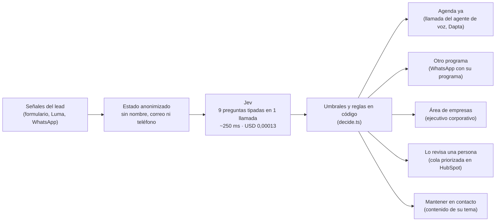

# Playbook: Jev Lead Router para 30X

> **Entregable ejecutivo (8 slides)** · Reto TypeSafe AI (Jev) en 30X · Área: **Comercial / Revenue Operations**
> **Demo:** [leads-router30x.vercel.app](https://leads-router30x.vercel.app/) · **Repo:** [github.com/juanmapath/leads-router30x](https://github.com/juanmapath/leads-router30x)
> Cifras al sáb 17 oct, 11:15: semana del demo (`data/week.json`, 250 leads), eval v3 (`data/eval-report-test.json`, 127 leads), línea base (`data/baseline-llm.json`). Los números de negocio son **supuestos conservadores** (`docs/supuestos.md`), no datos internos de 30X.

---

## Slide 1 · El problema: una barra de puntos para un catálogo de 17 programas

Cada semana, **200 a 300 personas** aplican a 30X (podcast con Dapta). La meta pública es pasar de **~10 % a 50 % de las ventas de punta a punta con IA**.

En los formularios públicos (`inmersivo-presencial-30x`, `ai-sales-30x`) encontramos tres cuellos de botella:

1. **Una suma fija de puntos descarta en automático.** En el Inmersivo, con 6 puntos o menos sobre 10 la persona ve *"Gracias por tu aplicación"*, aunque encaje en otro programa (USD 1.000–2.500) o venga a formar a su equipo.
2. **Un formulario sirve a 5 programas.** AI Sales, Sales Machine, Growth Rockstar, Advanced Strategy y Xtreme Growth comparten formulario; una suma de puntos no puede decidir cuál de los 17 programas necesita alguien.
3. **Nadie lee el texto libre.** "¿Cuál es la razón o desafío por la que aplicaste?" y la pregunta abierta de Luma no las evalúa ninguna regla.

**En una semana típica de 250 leads (mezcla supuesta, conservadora):** la regla manda **55** a entrevista y descarta **195** (175 ven "gracias" y 20 abandonan). Entre esos 195 hay **10 empresas** que venían a formar a su equipo y **66 personas** con un programa de 30X que sí les encaja.

---

## Slide 2 · La solución: Jev decide, el código pone los límites

Cada vez que alguien envía el formulario, se inscribe en Luma o responde por WhatsApp, **Jev Lead Router** hace **una llamada** a `typesafe-ai/jev` y el código elige la acción.

- **Jev no conversa ni redacta:** responde preguntas cerradas con probabilidades calibradas.
- **El código hace lo que Jev no debe hacer:** verificar que el formulario respalde una entrevista, cruzar categoría y programa, detectar abandonos y aplicar umbrales según el costo del error.

---

## Slide 3 · Las 9 preguntas tipadas (una sola llamada)

Catálogo oficial del Diagnóstico 30X (`src/engine/programs.ts`): **17 programas** para adultos en 6 categorías; 30X Next (menores) siempre va a una persona.

| Pregunta | Tipo | Qué evalúa | Cómo la usa el código |
| :--- | :--- | :--- | :--- |
| `ready` | bool | ¿Interés claro y capacidad de decidir o pagar esta semana? | Agenda exige ≥ 0,75 |
| `category` | choice (7) | Categoría de 30X de su necesidad | Si ≥ 0,65, el programa debe ser de esa categoría |
| `program` | choice (19) | Cuál de los 17 programas encaja (+ ninguno + otro) | Agenda ≥ 0,70 · otro programa ≥ 0,65 · < 0,60 va a una persona |
| `team` | bool | ¿Viene a formar a un equipo de su empresa? | ≥ 0,75 → área de empresas |
| `coherent` | bool | ¿Cargo, facturación, inversión y texto cuadran? | < 0,70 bloquea la agenda |
| `manipulation` | bool | ¿El texto intenta instruir al sistema? | ≥ 0,50 → una persona |
| `maturity` | score (3) | Madurez de IA de la empresa | Baja ≥ 0,9 con P(listo) < 0,15 → mantener en contacto (frío evidente); contexto para el SDR |
| `objection` | choice (6) | Objeción probable (precio, tiempo, decisor…) | Precio → ofrecer plan de pagos |
| `channel` | choice (4) | Canal del primer contacto | Se usa si ≥ 0,60; si no, el de la acción |

---

## Slide 4 · Umbrales por costo del error

Los umbrales (`src/engine/decide.ts`) son una **decisión de producto**, no un ajuste al set de prueba.

- **Error caro: agendar a quien no debía.** Quema tiempo de un closer. "Agenda ya" exige **tres candados**:
  1. `ready ≥ 0,75` y `program ≥ 0,70`;
  2. `coherent ≥ 0,70`;
  3. regla en código `formSupportsAgenda`: envío completo, cargo de decisión e inversión viable. **Un texto libre nunca agenda solo.**
- **Error barato: ofrecer otro programa por WhatsApp.** Exige `program ≥ 0,65` y coherencia con `category`.
- **La duda siempre va a una persona:** programa < 0,60 u "otro", contradicción entre categoría y programa, o intento de manipulación.
- **Reglas de negocio en código:**
  - un abandono nunca queda solo en "mantener en contacto": es la señal más caliente, y pasa a contacto rápido;
  - un lead solo de Luma con una sola señal nunca recibe oferta automática;
  - frío evidente (P(listo) < 0,15, madurez baja ≥ 0,9, sin equipo) va a "mantener en contacto" en vez de cargar al SDR.
- **Puerta de CI:** cada push falla si la acción baja de 76 % en el set de prueba o si aparece **una sola** entrevista mal agendada.

---

## Slide 5 · Segmento que se recalcula con cada señal

El brief pide **recalcular el segmento** a medida que la persona interactúa, empezando por Luma, donde solo deja nombre, correo y una pregunta opcional.

1. **Inscripción en Luma:** una sola señal de texto → **Lo revisa una persona**, con el programa sugerido ya calculado.
2. **Asiste a la clase o responde por WhatsApp:** Jev recalcula en ~250 ms; si la confianza supera el umbral pasa a **Otro programa** (p. ej. Operaciones con AI) o a **Área de empresas** si habla de su equipo.

Cada decisión cuesta ~USD 0,00013, así que recalcular en cada señal no es un costo que haya que pensar.

---

## Slide 6 · Por qué confiar: medido, calibrado y frente a un LLM

**Set de prueba de 127 leads nunca usado para ajustar**, la mitad "sucios": contradicciones, basura, contenido que no cuadra, solo Luma e intentos de *prompt injection*.

| Métrica (n = 127) | Jev Lead Router | Regla actual |
| :--- | :--- | :--- |
| Acción correcta | **83,5 %** (89 % en perfiles típicos) | — |
| Programa correcto (17 programas) | **86,3 %** · 92,9 % dentro de la categoría acertada | No elige programa |
| Venta a empresa identificada | **96,9 %** | No la ve |
| Entrevistas mal agendadas (error caro) | **0** | **27** |
| Errores que terminan frente a una persona | **71 %** (15 de 21) | — |

**Calibración:** cuando Jev reporta 90 % o más en el programa, acierta **97 %** (75 leads); por debajo de 60 %, menos de la mitad. Por eso, bajo 60 % nunca actúa solo.

**Jev frente a Claude Sonnet 5.5** (mismos 20 leads, mismas preguntas, mismos umbrales):

| | Jev | Sonnet 5.5 |
| :--- | :--- | :--- |
| Acción correcta | 19 de 20 | 18 de 20 |
| Entrevistas mal agendadas | 0 | 0 |
| Latencia media / 5 % más lento | **236 / 433 ms** | 2.111 / 5.370 ms |
| Costo por 1.000 decisiones | **USD 0,13** | USD 13,34 |

> **Lectura honesta:** un LLM general acierta casi igual. La diferencia es que Jev es **~9× más rápido** y **~100× más barato**, con probabilidades medidas. Eso permite **decidir dentro del formulario**, antes de que cargue la página final, y recalcular con cada señal. El LLM queda para redactar mensajes.

---

## Slide 7 · Quién lo opera y cómo se mide

**Dónde vive Jev (supuestos, a confirmar con 30X):**
- **A (preferido):** al terminar, el formulario redirige a una URL nuestra; Jev decide en ~250 ms y la persona ve un calendario, la oferta de su programa o una página de seguimiento en vez de "gracias". Los ms importan aquí: un LLM general (~2,1 s de media y más de 5 s en el 5 % más lento) no cabe antes de que cargue la página.
- **B (respaldo):** webhook en < 1 s; la página final no cambia, pero el primer contacto sale en el primer minuto.

**Integración con el stack de 30X:**
- **Privacidad (Ley 1581):** `buildState` nunca incluye nombre, correo ni teléfono; el texto libre va truncado a 300 caracteres y marcado como dato, no instrucción.
- **HubSpot:** se escriben `jev_accion`, `jev_programa`, `jev_categoria`, `jev_p_listo`, `jev_p_empresa`, `jev_objecion`, `jev_canal` y `jev_revisar` en el contacto, y se asigna (AE de empresas, closer, equipo de la categoría o SDR).
- **Agenda ya** → llamada inmediata del agente de voz (Dapta) · **Otro programa** → plantilla de WhatsApp con su programa · **Área de empresas** → tarea al ejecutivo corporativo · **Lo revisa una persona** → cola priorizada del SDR con la razón en español.
- **Mensajes:** plantillas fijas por acción, programa y canal (`src/engine/actions.ts`); un test exige que cada combinación tenga una y que "Lo revisa una persona" nunca muestre una oferta (muestra "un asesor te escribe hoy"). Redactar con IA queda para la fase 2.
- **Quién ajusta:** los umbrales son perillas del negocio; ser más conservador con la Inmersión es subir un número, no reescribir prompts.

**Cómo se mide:**
- % de leads contactados en menos de 5 minutos.
- Reuniones canceladas por mala calificación.
- Ventas de otros programas desde leads que la regla descartaba.
- % de leads con siguiente paso sin intervención humana (hoy **76 %** en la semana del demo), hacia la meta de 50 % de ventas con IA.

---

## Slide 8 · Costo, impacto y el piloto que pedimos

**Costo de operar** (250 leads/semana × 3 decisiones por lead): **~USD 0,41 al mes con Jev** frente a **~USD 43 con un LLM general**.

**Impacto estimado** (supuestos de `docs/supuestos.md`: ticket realizado 85 % del precio público, plan corporativo USD 7.500):

| | Pesimista | Viable | Optimista |
| :--- | :--- | :--- | :--- |
| Cierre de ofertas de otro programa | 1,5 % | 3 % | 5 % |
| Cierre de oportunidades de empresa | 3 % | 6 % | 10 % |
| **Ventas incrementales al mes** | **del orden de USD 13.000** | del orden de USD 27.000 | del orden de USD 45.000 |

Base: 66 ofertas por semana (del orden de USD 66.000 de pipeline de lista) + 10 oportunidades de empresa. **Prueba de cordura** (test automático): el escenario pesimista no supera el 10 % de unas ventas estimadas de ~USD 150.000 al mes.

### El pedido: una semana en modo sombra
- **Lunes:** webhook de solo lectura desde el formulario o HubSpot hacia Jev Lead Router.
- **Martes a viernes:** con los leads reales, Jev escribe propiedades ocultas (`jev_shadow_action`, `jev_shadow_program`, `jev_shadow_reasons`) **sin enviar mensajes ni cambiar lo que ve el lead**. Costo: menos de 10 centavos de dólar.
- **Viernes:** con Ventas y Tech revisamos la mezcla real, cuántos descartados tenían programa, cuántas entrevistas habría filtrado y si el formulario puede redirigir. Con eso se reemplazan los supuestos y se decide qué rutas encender.
