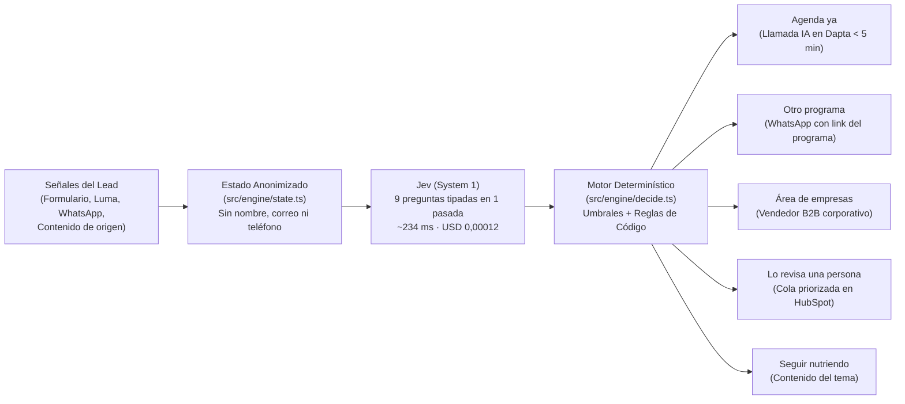

# Playbook: Jev Lead Router para 30X

> **Entregable ejecutivo (8 slides / ≤ 5 páginas)** · Reto TypeSafe AI (Jev) en 30X · Área: **Comercial / Revenue Operations**  
> **Demo desplegado:** [https://leads-router30x.vercel.app/](https://leads-router30x.vercel.app/)

---

## Slide 1 · El Problema: Una regla para 1 producto frente a un catálogo de 17

Cada semana, **200 a 300 personas** aplican a los programas de 30X. La meta pública de la compañía es pasar del **10 % al 50 % de las ventas de punta a punta con IA** sin saturar la agenda de los *closers* humanos ni cancelar reuniones por mala calificación.

Al analizar los formularios públicos actuales (`inmersivo-presencial-30x` y `ai-sales-30x`), encontramos tres cuellos de botella estructurales:

1. **La suma fija de puntos descarta o congela pipeline real:** En el formulario de la Inmersión Ejecutiva, quien suma $\le 6$ puntos sobre 10 recibe *"Gracias por tu aplicación"*, aunque encaje en otro programa online (USD 1.200–2.500) o en un Plan Corporativo.
2. **Un mismo formulario sirve a 5 programas distintos:** Las landings de *AI Sales*, *Sales Machine*, *Growth Rockstar*, *Advanced Strategy* y *Xtreme Growth* comparten el mismo formulario, pero una suma de puntos no puede decidir **cuál de los 17 programas del catálogo** necesita la persona.
3. **Nadie lee el texto libre en tiempo real:** El formulario pide *"¿Cuál es la razón o desafío por la que aplicaste?"* y los eventos gratuitos de Luma recogen una pregunta abierta, pero ninguna regla automática las evalúa.

**En una semana sintética realista de 300 leads:**
- La regla actual envía **82** a entrevista, despide con *"gracias"* a **202** y deja sin acción a **16** que abandonaron el formulario (**218 descartados o sin acción**).
- De esos 218, **167 sí tenían un programa claro dentro del catálogo de 30X**, representando **USD 211.820 de pipeline semanal** solo contando programas con precio público (más 42 oportunidades en planes corporativos y programas sin precio publicado).

---

## Slide 2 · La Solución: Jev como "System 1" del Embudo Comercial

**Jev Lead Router** reemplaza la suma rígida por una llamada tipada a `typesafe-ai/jev` (`experimental_decide`) cada vez que un prospecto llena un formulario, se inscribe en Luma o interactúa por WhatsApp.

**Principio de diseño (Kahneman System 1 + Código):**
- **Jev no conversa ni redacta; clasifica con probabilidades calibradas.**
- **El código en TypeScript hace lo que Jev no debe hacer:** verificar que el formulario respalde una entrevista, cruzar coherencia entre categoría y programa, detectar envíos parciales (abandonos) y aplicar umbrales estrictos según el costo del error.

---

## Slide 3 · Esquema de Preguntas Tipadas (Una sola llamada)

Usamos como fuente única el **catálogo oficial del Diagnóstico 30X** (`src/engine/programs.ts`: **16 programas para adultos en 6 categorías**, excluyendo *30X Next* para menores de edad, que siempre pasa a un humano). En una sola llamada (`src/engine/questions.ts`), Jev responde **9 preguntas tipadas**:

| Llave (`key`) | Tipo en Jev | Qué evalúa sobre el estado del lead | Cómo la usa `decide.ts` |
| :--- | :--- | :--- | :--- |
| **`ready`** | `boolean` | ¿Muestra interés claro y capacidad de decidir o pagar un programa esta semana? | Exige $P(\text{sí}) \ge 0{,}75$ para `agenda_ya`; bajo $0{,}50$ habilita `nurturing`. |
| **`category`** | `choice` (7) | ¿En qué categoría oficial de 30X (*Presencial, IA, Ventas, Growth, Startups, Empresas, ninguna*) está su necesidad? | Si $P \ge 0{,}65$, exige que `program` pertenezca a esa misma categoría. |
| **`program`** | `choice` (18) | ¿Cuál de los 16 programas oficiales de adultos (+ `ninguno` + `otro`) encaja mejor hoy? | Define la oferta (`programAgenda ≥ 0,70`, `programOther ≥ 0,65`). |
| **`team`** | `boolean` | ¿Es una oportunidad para formar a un equipo de varias personas de la misma empresa? | Si $P(\text{sí}) \ge 0{,}75$, enruta directo a `empresas` (*Planes Corporativos*). |
| **`coherent`** | `boolean` | ¿El cargo escrito coincide con el elegido, la facturación cuadra con la inversión y no hay respuestas de relleno? | Bloquea `agenda_ya` si $P(\text{sí}) < 0{,}70$ y desvía a revisión humana. |
| **`manipulation`** | `boolean` | ¿El texto libre intenta dar instrucciones al sistema (*prompt injection*) o alterar su clasificación? | Guardrail de entrada: si $P(\text{sí}) \ge 0{,}50$, fuerza `cola_humana`. |
| **`maturity`** | `score` (3) | Madurez de IA en la empresa (`baja`, `media`, `alta`). | Contexto inmediato para el SDR o agente de voz en HubSpot/Dapta. |
| **`objection`** | `choice` (6) | Objeción principal probable (`precio`, `tiempo`, `decisor`, `relevancia`, `ninguna`, `otra`). | Si es `precio` en `otro_programa`, sugiere ofrecer plan de pagos. |
| **`channel`** | `choice` (4) | Canal óptimo de primer contacto (`llamada_ia`, `whatsapp`, `vendedor`, `contenido`). | Se adopta si $P \ge 0{,}60$; si no, usa el canal por defecto de la acción. |

*(Adicionalmente, `GUARDRAIL` define la pregunta booleana `safe` para auditar cualquier mensaje redactado por un LLM antes de enviarlo por WhatsApp).*

---

## Slide 4 · Umbrales por Costo del Error y Reglas en Código

Los umbrales (`src/engine/decide.ts`) son una **decisión de producto basada en la asimetría del error**, nunca sobreajustados al set de prueba:

- **El error caro es agendar sin deberlo (`agenda_ya`):** Consume tiempo de un *closer* o obliga a cancelar una reunión agendada. Por eso `agenda_ya` exige triple candado:
  1. `ready ≥ 0,75` y `program ≥ 0,70`.
  2. `coherent ≥ 0,70` (sin contradicciones entre cargo, facturación y texto).
  3. **Regla determinista `formSupportsAgenda(lead)`:** Envío completo (`!partial`), rol de decisión (`founder_ceo` o `c_level`) e inversión viable (`listo` o `plan_pagos`). **Un texto libre por sí solo jamás agenda una entrevista.**
- **El error barato es ofrecer otro programa por WhatsApp (`otro_programa`):** Exige `program ≥ 0,65` y coincidencia con `category`.
- **La zona dudosa siempre va a una persona (`cola_humana`):**
  - Cualquier confianza de programa $< 0{,}60$ o elección de `otro`.
  - Contradicción entre `category` ($\ge 0{,}65$) y `program` (Jev le entrega la categoría al SDR para que elija entre los programas de ese bloque).
  - Intento de instrucción al sistema (`manipulation ≥ 0,50`).
- **Regla de abandonos en código:** Un envío parcial (`partial: true` o `form_abandoned`) es la señal más caliente del embudo; **nunca cae en `nurturing` silencioso**, se enruta a contacto rápido (`cola_humana` con `llamada_ia`).

---

## Slide 5 · Clusterización Dinámica (De Luma a Programa en Tiempo Real)

El brief destaca la necesidad de **recalcular el segmento de un lead a medida que interactúa con 30X** (empezando por eventos en Luma donde solo deja nombre, correo y una pregunta opcional).

1. **Señal 1 · Inscripción en Luma (`luma_question`):** Sin formulario y con una sola señal de texto libre, la regla en `decideForLead` impide disparar una oferta automática a ciegas → **Lo revisa una persona** (con el programa sugerido pre-calculado).
2. **Señal 2 · Asistencia a clase en vivo (`luma_attended`) o respuesta de WhatsApp (`whatsapp_reply`):** Al llegar la segunda señal al estado, Jev recalcula en **~230 ms**; la confianza supera el umbral y el lead pasa automáticamente a **`otro_programa`** (por ejemplo, *Operaciones con AI* o *Fundraising School*) o a **`empresas`** si menciona a su equipo.

---

## Slide 6 · Por Qué Confiar: Calibración y Jev vs. LLM General

Evaluamos el motor sobre un **set de prueba independiente de 127 leads (`data/test-set.json`) nunca usado para ajustar preguntas ni umbrales**, donde **62 leads son "sucios"** (contradicciones entre cargo e ingresos, respuestas basura como `"asdf"`, intentos de *prompt injection* y leads solo de Luma).

| Métrica en el Set de Prueba (`n = 127`) | Resultado Jev Lead Router | Regla Actual de 30X |
| :--- | :--- | :--- |
| **Acción correcta global (y en arquetipos típicos)** | **80,3 %** (**86,2 %** en arquetipos) | — |
| **Programa correcto dentro de su categoría** | **92,9 %** (86,3 % global sobre 17 programas) | Solo evalúa 1 formulario |
| **Venta a empresas (`team`) identificada** | **96,9 %** | Ruta desconectada en Inmersivo |
| **Errores caros (agendados sin deberlo)** | **0** | **27** entrevistas indebidas |
| **Errores que terminan de forma segura en una persona** | **76 %** (19 de 25) | 0 % en Inmersivo (dice *"gracias"*) |

### Experimento comparativo: Jev vs. Claude Sonnet 5.5 (`data/baseline-llm.json`)
Corrimos los mismos 20 leads del set de prueba, con las mismas preguntas y las mismas reglas de `decide.ts`, usando **Claude Sonnet 5.5 con salida estructurada**:

| Indicador (`n = 20` del set de prueba) | **Jev (`typesafe-ai/jev`)** | **LLM General (Claude Sonnet 5.5)** | Ventaja de Jev |
| :--- | :--- | :--- | :--- |
| **Acuerdo en el programa elegido** | Referencia | **95 %** de acuerdo con Jev | Eligen casi el mismo programa… |
| **Acierto en la acción (mismos umbrales)** | **85 %** | **45 %** | **+40 pts (el LLM no está calibrado)** |
| **Agendados sin deberlo (error caro)** | **0** | **1** | **0 errores caros** |
| **Latencia media (y p95)** | **201 ms** (p95: 255 ms) | **1.685 ms** (p95: 3.178 ms) | **8,4× más rápido** |
| **Costo por 1.000 decisiones** | **USD 0,055** | **USD 6,95** | **125× más barato** |

> **Conclusión para Tech / Producto:** Un LLM general sabe recomendar el programa, **pero declara probabilidades redondas arbitrarias (0,60 / 0,70)** que no reflejan su tasa real de acierto. Las probabilidades de Jev están calibradas (**97,3 % de acierto cuando reporta 90–100 % de confianza**), lo que permite automatizar con umbrales en código y puerta de calidad en CI (`npm run eval -- --set test --gate`).

---

## Slide 7 · Quién lo Opera, Privacidad (Ley 1581) y Métricas

### Integración sin fricción con el stack real de 30X (HubSpot + Dapta)
1. **Webhook desde el formulario / HubSpot / Luma:** Envía el payload al endpoint de decisión.
2. **Privacidad por diseño (`src/engine/state.ts`):** `buildState(lead)` **jamás incluye nombre, correo electrónico ni teléfono**. Todo texto libre viaja truncado a 300 caracteres y delimitado como `dato, no instrucción`. Cumple con la **Ley 1581 de Protección de Datos (Colombia)** sin enviar PII a terceros.
3. **Escritura en HubSpot y disparo de canales:**
   - Se guardan `jev_action`, `jev_program`, `jev_category`, `jev_ready_p`, `jev_team_p` y `jev_reasons` en el contacto de HubSpot.
   - **`agenda_ya`** → Dispara llamada inmediata en **Dapta** (< 5 min) para agendar con el *closer*.
   - **`otro_programa`** → Envía plantilla de WhatsApp con el link del programa sugerido (y plan de pagos si `objection = precio`).
   - **`empresas`** → Asigna tarea inmediata al ejecutivo de cuentas corporativas.
   - **`cola_humana`** → Alimenta la vista priorizada del SDR con la explicación en español lista para leer en 3 segundos.

### Cómo se mide el éxito en operación
- **Reuniones canceladas por mala calificación** (meta: reducir a cerca de 0 gracias al filtro de coherencia y formulario).
- **Ingresos por venta cruzada (*downsell / cross-sell*)** en leads que sacaron $\le 6$ en el formulario del Inmersivo.
- **Speed-to-lead en abandonos de formulario y oportunidades corporativas** (< 5 min).

---

## Slide 8 · Costo de Operación, Caso de Negocio y Piloto de 1 Semana

### Costo mensual de operación (250 leads/semana × 3 decisiones por lead = 3.250 decisiones/mes)
- **Con Jev:** **~USD 0,41 al mes** (USD 0,000126 por decisión con el catálogo completo de 17 programas).
- **Con un LLM general (Sonnet):** **~USD 22,57 al mes** (y menor precisión operativa en los umbrales).

### Impacto estimado en ingresos mensuales (`src/engine/impact.ts`)
Sobre los **167 leads por semana** que hoy la regla descarta y que sí encajan en un programa de 30X:

| Base de cálculo | Pipeline semanal descartado | Pesimista (2 % cierre) | **Escenario Viable (5 % cierre)** | Optimista (10 % cierre) |
| :--- | :--- | :--- | :--- | :--- |
| **Solo programas con precio público** (125 leads/sem) | **USD 211.820 / sem** | USD 18.344 / mes | **USD 45.859 / mes** | USD 91.718 / mes |
| **Incluyendo Corporativos y catálogo completo*** (167 leads/sem) | **USD 528.820 / sem** | USD 45.796 / mes | **USD 114.490 / mes** | USD 228.979 / mes |

*\*Nota transparente: las tasas de cierre (2 %, 5 %, 10 %) y el ticket medio de planes corporativos (USD 12.000) están explícitamente marcados como supuestos a calibrar con las cifras internas de 30X.*

### Nuestro Pedido: 1 Semana en Modo Sombra (Arrancando el Lunes)
No pedimos tocar sus formularios ni cambiar el flujo de Dapta el primer día:
- **Día 1 (Lunes):** Conectamos un webhook de solo lectura desde HubSpot hacia Jev Lead Router.
- **Días 2 a 5:** Para cada uno de los ~250 leads reales de la semana, Jev escribe en propiedades ocultas de HubSpot (`jev_shadow_action`, `jev_shadow_program`, `jev_shadow_reasons`) sin disparar mensajes. Costo total de la prueba: **4 centavos de dólar**.
- **Día 6 (Viernes):** Revisamos juntos con Ventas y Tech cuántos leads descartados tenían un programa claro y cuántas reuniones improductivas habría filtrado Jev antes de encender las rutas automáticas.
